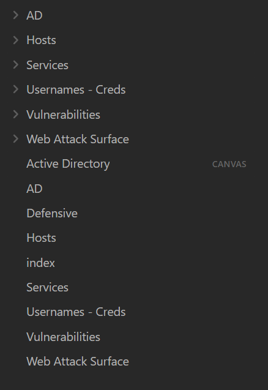
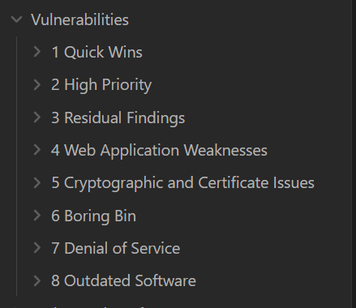
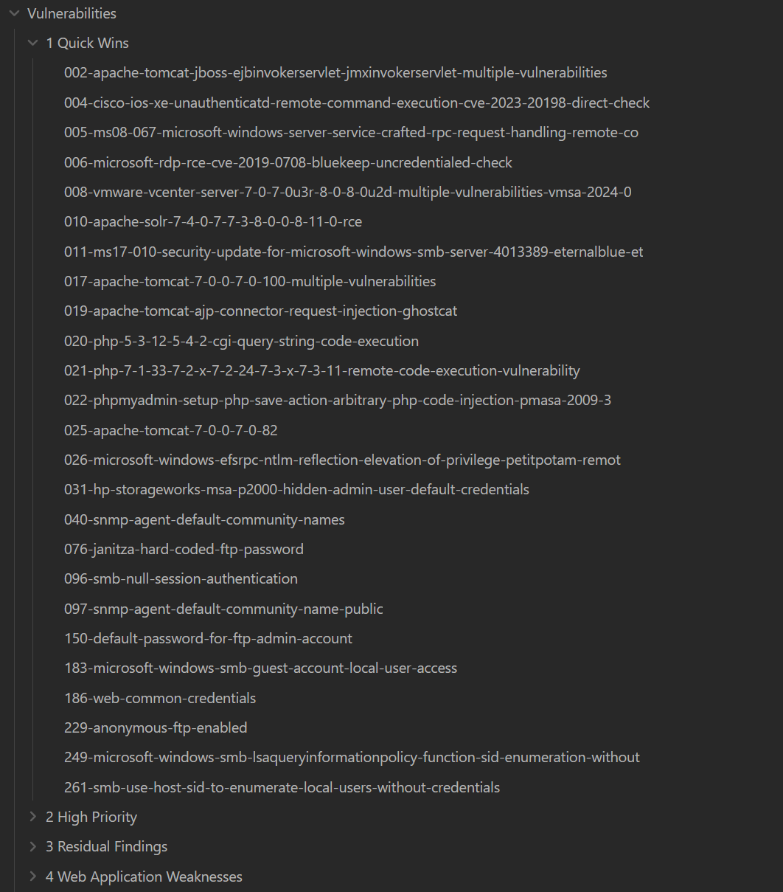
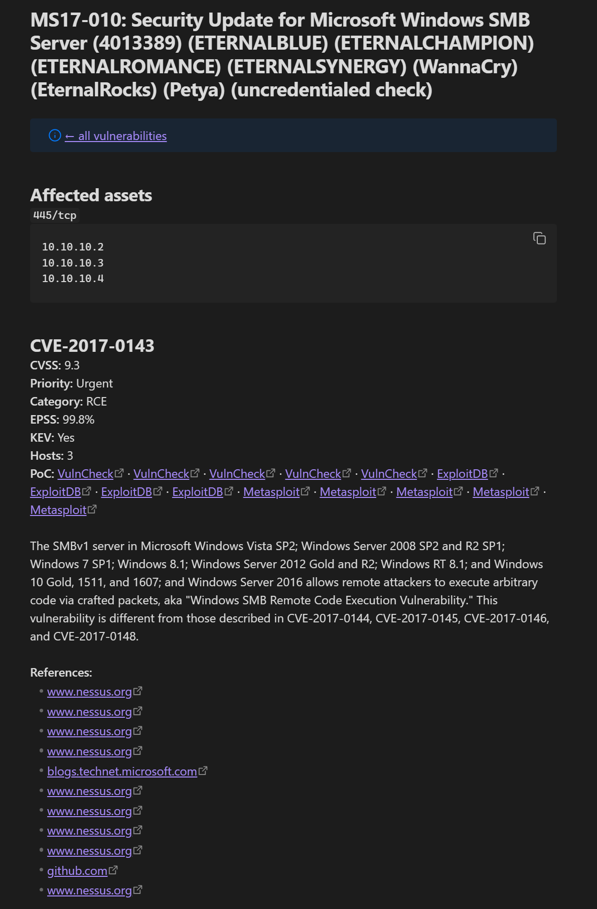
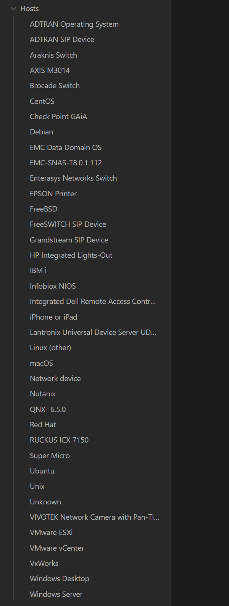
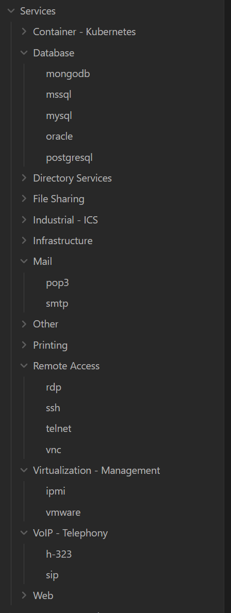
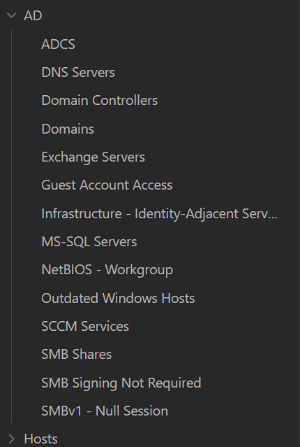
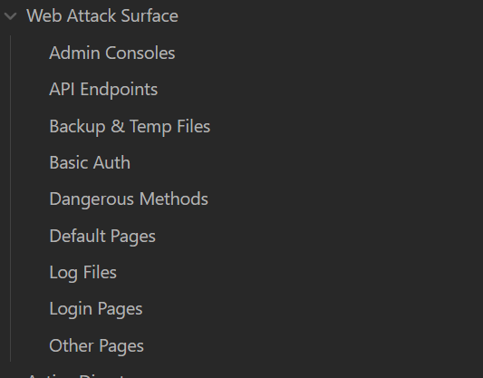

# layzmd

**layzmd** turns a Nessus CSV export into an [Obsidian](https://obsidian.md) vault you can actually
work from: hosts, services, prioritised vulnerabilities, Active Directory findings, and a ready-to-copy
web attack surface, all as linked Markdown notes with native Obsidian callouts and properties. Every
CVE is enriched with CISA KEV, FIRST EPSS, NVD, and public proof-of-concept data.

One static Go binary. No runtime, no install, no database. Point it at the CSV and open the folder.

<p align="center">
  
</p>

## What you get

### Vulnerabilities, ranked and bucketed

Findings are merged by product and vulnerability class, scored (severity + EPSS + KEV), and sorted into
semantic buckets so the things worth doing first are in folder `1`. Each note is numbered by its global
priority rank.

<p align="center">
  
</p>

**Quick Wins** collects findings with a Metasploit module, default or hard-coded credentials, null
sessions, anonymous FTP, and similar low-effort, high-payoff items:

<p align="center">
  
</p>

Each finding note gives you the affected assets as a copyable code block per port, then one section per
CVE with CVSS, priority, category, EPSS, KEV status, host count, PoC links (VulnCheck, ExploitDB,
Metasploit), the NVD description, and references:

<p align="center">
  
</p>

### Hosts and Services

Hosts are grouped by operating system family, then by specific OS version. Services are named with a
confidence-tiered resolver (Nessus service detection, then a curated port map, then plugin-name hints)
and filed under a category, one note per service with a per-port IP list.

<table align="center">
  <tr>
    <td align="center"></td>
    <td align="center"></td>
  </tr>
  <tr>
    <td align="center"><sub>Hosts by OS</sub></td>
    <td align="center"><sub>Services by category</sub></td>
  </tr>
</table>

### Active Directory

Domains, domain controllers, ADCS, SCCM, Exchange, MS-SQL, DNS, SMB shares, SMB signing, SMBv1 and
null sessions, guest access, outdated Windows hosts, and identity-adjacent infrastructure, each as its
own note. Detected defensive technologies and harvested email addresses get their own top-level notes,
and an **Active Directory.canvas** lays the attack surface out visually.

<p align="center">
  
</p>

### Web Attack Surface

Every browsable web endpoint from the scan, sorted into pentester-first categories. Each category note is
a single code block of absolute URLs, ready to paste into a browser, Burp, or a wordlist.

<p align="center">
  
</p>

Each category note looks like this (IPs from a real scan omitted):

```
https://10.0.4.21:443/manager/html
https://10.0.4.21:8443/phpMyAdmin
https://10.0.7.3:443/admin/
https://10.0.9.110:443/ui/
```

## Install

**Prebuilt binary:** download from the GitHub Releases page and place it on your PATH.

**From source (Go 1.26+):**

```sh
go build .
```

**Cross-compile release binaries (Windows, Linux, macOS amd64 + arm64):**

```sh
bash scripts/build-release.sh [version]
# Produces dist/layzmd_<version>_<os>_<arch>[.exe]
```

## Usage

```sh
layzmd --csv scan.csv --out ./vault
```

Then open `./vault` as a vault in Obsidian and start from `index.md`.

When `--csv` or `--out` are omitted, layzmd opens a native file or directory picker, so double-clicking
the binary works too. The output folder opens automatically when the run finishes.

### Flags

| Flag | Default | Description |
|------|---------|-------------|
| `--csv` | *(dialog)* | Path to the Nessus CSV export |
| `--out` | *(dialog)* | Output directory for the Markdown vault |
| `--nvd-key` | `""` | NVD API key (falls back to `$PTC_NVD_API_KEY`) |
| `--no-enrich` | `false` | Skip all network enrichment; use cached data only |
| `--refresh` | `false` | Ignore cached enrichment and force a refetch |
| `--version` | | Print version and exit |

## Enrichment

Each CVE is enriched from:

- **CISA KEV**: known exploited vulnerabilities catalog
- **FIRST EPSS**: exploit prediction score and percentile
- **NVD**: CVSS, CWE, and description
- **PoC sources**: VulnCheck, ExploitDB, and Metasploit references (Nuclei templates are listed
  separately and do not count as a PoC)

Results are rate-limited per source and cached under your OS cache directory, so re-runs are fast and
work offline.

- `--no-enrich`: fully offline; only previously cached data is used, no network calls
- `--refresh`: ignore the cache and refetch everything

### NVD API key

Without a key, NVD allows 5 requests per 30 seconds. A free key raises that to 50, which matters on a
large scan. Get one at <https://nvd.nist.gov/developers/request-an-api-key>, then pass `--nvd-key <key>`
or set `PTC_NVD_API_KEY`.

When launched by double-click with no key configured, layzmd asks for one in a dialog and remembers it
between runs (stored under your OS user-config directory). Leave it blank to run anonymously.

## Output vault

| Note | Contents |
|------|----------|
| `index.md` | Summary counts and links to every section |
| `Vulnerabilities.md` + `Vulnerabilities/` | Priority dashboard, then one note per finding in numbered bucket folders |
| `Hosts.md` + `Hosts/` | Hosts by OS family, one note per family with per-version IP lists |
| `Services.md` + `Services/` | Services by category, one note per service with per-port IP lists |
| `AD.md` + `AD/` | Active Directory analysis, one note per detection |
| `Defensive.md` | Detected defensive technologies (EDR, AV, WAF, etc.) |
| `Usernames - Creds.md` + folder | Email addresses harvested from web, certificate, and AD plugin output |
| `Web Attack Surface.md` + folder | Web endpoints by category as URL code blocks |
| `Active Directory.canvas` | Obsidian canvas of the AD attack surface |

All notes use native Obsidian callouts (`> [!type]`), wikilinks, and YAML properties, so they render
cleanly and work with the Properties panel, graph view, and Dataview.

## License

MIT. See [LICENSE](LICENSE).
